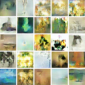

# WikiArt DCGAN

ECE 285 painting synthesis experiment using 10,000 WikiArt images for training and 512 held-out images for evaluation. The generator produces 32 × 32 RGB images from 64-dimensional Gaussian noise.



## Reproduce the experiment

Use Python 3.10 and install the dependencies in a virtual environment. Run the commands from the repository root.

```sh
python -m pip install -r requirements.txt
python fetch.py
python train.py
python evaluate.py
python figures.py
```

`fetch.py` reads selected images from the public [WikiArt dataset](https://www.kaggle.com/datasets/steubk/wikiart). Sampling uses seed 285. The first 10,000 paths in `manifest.json` are training images and the last 512 are evaluation images.

`train.py` runs 40 epochs and saves the generator weights, per-epoch loss log and fixed-noise grids. `evaluate.py` uses the Ignite tutorial's 1,000-dimensional Inception probability features and seed 286. On the recorded run, probability-space FID was 0.0434 and generated-image Inception Score was 1.93. The held-out paintings scored 2.59.
